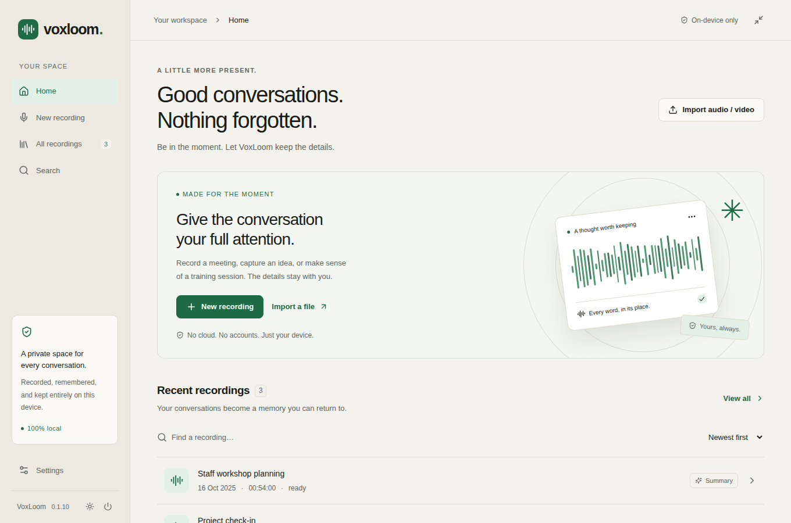
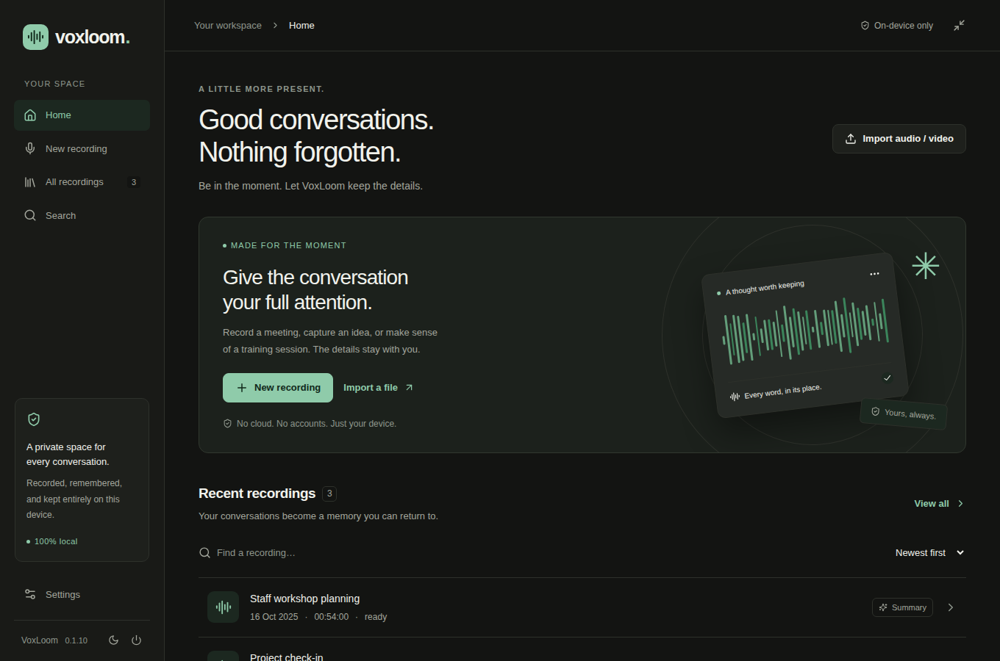
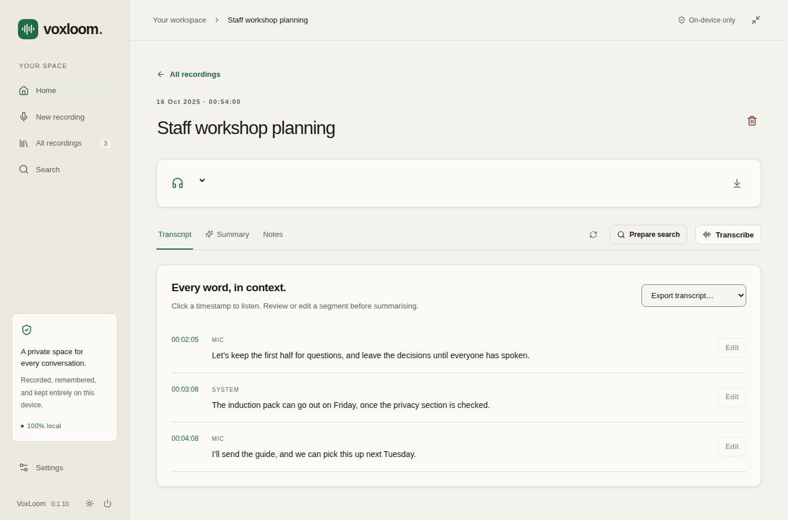

# VoxLoom

A private desktop recorder and transcript library for Linux and Windows 11. It records microphone and/or system audio, transcribes while you record, and searches what was said on your own computer. All inference runs locally. Summaries and Q&A happen only when you ask.

| Platform | Package | State |
|---|---|---|
| Ubuntu 24.04+ (x86_64) | `.deb` | Functional development preview; the long-standing platform, tested on real recordings |
| Windows 11 (x64) | `.exe` installer (per-user or all users) and a preview `.zip` | Installer, bundled runtime and the full import → transcribe → search → summary → export → delete workflow are tested on GitHub's Windows machines. Recording is implemented but still needs a real Windows 11 laptop with audio devices |
| macOS, Windows 10, Windows on Arm | — | Not supported |

The pictures below use sample titles so you can see the layout. Your own library starts empty. They show the Linux build; the Windows app has the same interface.







## For everyday use

VoxLoom records a conversation on your own computer and keeps the words so you can find them later. The recording, the transcript and any notes stay on this machine. Nothing is uploaded, and there is no account.

**Open it.** After VoxLoom is installed, it appears in the applications menu on Linux or the Start menu on Windows.

**First time.** Choose **Download & set up** if you want transcripts, search and notes. That download happens once, and only when you ask. You can skip it and still record; the text can be prepared later.

**Record.** Choose **New recording**, then **Microphone** (people in the room), **System audio** (a call or a video playing on this computer), or **Both**. On Windows, allow desktop apps to use the microphone in Settings → Privacy & security → Microphone → **Let desktop apps access your microphone**; VoxLoom offers to open that page if it is off. People should know you are recording. Press **Stop** when you are done. Words appear a few seconds after someone pauses.

**Read it back.** Open the recording. Click a time to hear that moment, and correct a line if a word is wrong.

**Notes, only if you ask.** **Summarise** writes notes from the transcript. Copy them formatted for Word or your case notes, or as Markdown. Starting or importing a recording never writes notes by itself.

**Find something later.** **Search** looks through what was said, on this computer.

**Light or dark.** The icon beside **Quit** in the sidebar switches the theme. **Settings** has the same choice, including **System**, which follows the desktop.

Current build: a functional development preview on both platforms. Real Whisper, native-audio EmbeddingGemma 2 740M retrieval and on-demand Gemma 4 E2B summaries have been exercised on both; Linux synthetic dual capture has also been exercised. Windows has been tested end to end on machines without audio devices, so real microphones, loopback and headset switching still need a Windows 11 laptop. Business meeting quality, physical-device behaviour and multi-hour reliability still need wider testing. See [testing and measurements](docs/TESTING.md) and [VoxLoom on Windows](docs/WINDOWS.md).

## Install a release

Ready-made builds are attached to the [GitHub Releases page](https://github.com/chencyberlab/VoxLoom/releases). The application never downloads anything until you choose **Download & set up**, and contacts GitHub only when you click **Check for updates**.

### Ubuntu 24.04+ (x86_64)

Install `voxloom_<version>_amd64.deb`, replacing `<version>` with the release number:

```bash
sudo apt install ./voxloom_<version>_amd64.deb
```

Open VoxLoom from the applications menu. On first run, **Download & set up** installs the private search runtime and the models you choose (about 3.6 GB with the default E2B summary model). You can skip setup and still record; the text can be prepared later. Upgrades keep your recordings, models and settings.

If you built the app in this checkout, the package is in `release/`; install it the same way.

### Windows 11 (x64)

VoxLoom requires 64-bit Windows 11. Download `VoxLoom-<version>-windows-x64-setup.exe` and run it. The installer asks whether to install:

- **for you only** in `%LOCALAPPDATA%\Programs\VoxLoom`, which needs no administrator rights, or
- **for everyone on the computer** in `C:\Program Files\VoxLoom`, which needs an administrator.

It includes everything the app needs: VoxLoom, FFmpeg, its own Python with LiteRT, and the speech and summary engines. Nothing else has to be installed, and WebView2 is part of Windows 11. Only models are downloaded, through first-run setup or an offline import.

The installer and preview zip are not code-signed yet, so Windows SmartScreen may warn on first run: choose **More info → Run anyway**. Managed laptops may block them until IT allows them; each release includes a list of every installed program file with its SHA-256 to help with that.

To try VoxLoom without installing, download `VoxLoom-<version>-windows-x64-preview.zip`, unzip it into a folder of your choice and open `voxloom.exe`. It uses the same library as an installed copy.

Upgrading keeps recordings, transcripts, models and settings. One exception: when upgrading from 0.1.19, choose **Do not uninstall** in the newer setup, or its older clean-up deletes the downloaded models; [VoxLoom on Windows](docs/WINDOWS.md) explains why. Uninstalling removes the program, the bundled runtime, downloaded models and caches, and keeps your recordings and transcripts unless you tick “Also delete my recordings, transcripts and settings”. Silent install and uninstall switches, per-machine clean-up limits and other IT details are in the same document.

### Updates

In **Settings → Updates**, **Check for updates** asks GitHub once whether a newer release has been published. VoxLoom never checks by itself, and the request carries only the app's version number, nothing from your recordings. If there is a newer one, **Get VoxLoom** opens its release page in your browser. Download the file for your computer and install it over the current version, as above: on Ubuntu `sudo apt install ./voxloom_<version>_amd64.deb`, on Windows run the new setup. Your recordings, transcripts, models and settings stay.

## Build the app yourself (step by step)

### Linux

You need an Ubuntu 24.04 (or newer) x86_64 computer, an internet connection for the first build, and about 6 GB of free disk space. No programming knowledge is needed.

1. **Get the code.** Download or clone this repository and open a terminal in its folder.
2. **Build.** Run:

   ```bash
   bash scripts/build-app.sh --install-deps
   ```

   The script does everything in order and stops with a clear message if something is missing:
   - installs the Ubuntu packages listed below (it asks for your password once)
   - installs private copies of Node.js 24 and Rust into `.toolchain/` if your computer doesn't have them; your system and shell settings are not changed
   - downloads the JavaScript libraries
   - compiles the speech and summary engines from pinned, checksum-verified sources. This happens only the first time and takes about 5–15 minutes; the whole first build took about 9 minutes on a 4-core laptop.
   - builds the app and copies the result into `release/`

   Add `--check` to run the automated tests before building.
3. **Install.** The script prints the exact command at the end, for example:

   ```bash
   sudo apt install ./release/voxloom_<version>_amd64.deb
   ```

   Or run it without installing: `release/VoxLoom-<version>/voxloom`.
4. **First run.** Open VoxLoom from the applications menu and choose **Download & set up** to fetch the AI models (about 3.6 GB with the default summary model). Models are never part of the build.

To build again after pulling changes, run `bash scripts/build-app.sh`. Later builds take a few minutes. Upgrading keeps your recordings, models and settings.

System packages the script installs or checks (to install them yourself):

```bash
sudo apt-get install -y --no-install-recommends build-essential cmake pkg-config curl libwebkit2gtk-4.1-dev libgtk-3-dev librsvg2-dev libayatana-appindicator3-dev patchelf ffmpeg pulseaudio-utils python3 python3-venv
```

### Windows

The Windows package bundles a runtime that is cross-built on Linux from pinned sources. Release builds are made by the Apps workflow (Actions → Apps), which builds and checks the installer and preview zip on GitHub's Windows machines. To build locally:

1. **Build the runtime on Linux.** With `mingw-w64`, `cmake`, `make`, `nasm`, `curl` and `python3-venv` installed:

   ```bash
   bash scripts/build-windows-runtime.sh
   ```

   The first full build takes about 20 minutes and writes `engines/`, `python/`, `licenses/` and `VERSIONS.txt` to `.local-data/windows-runtime/`.

2. **Stage it on Windows.** Copy those four items into `src-tauri/` in the checkout.

3. **Build on Windows 11 x64.** Install Node 24, Python 3.13, Rust stable with the MSVC toolchain, and Visual Studio Build Tools with “Desktop development with C++”. Then:

   ```powershell
   npm ci
   npx tauri build
   ```

   The installer appears under `src-tauri/target/release/bundle/nsis/`. `python scripts/package-windows-preview.py <output-folder>` makes the no-install zip from the same build. Models are never included.

Full details, including how the runtime is assembled and why it is bundled, are in [VoxLoom on Windows](docs/WINDOWS.md).

## Run this checkout for development

### Linux

```bash
bash scripts/run-local.sh
```

This uses the Git-ignored `.local-data/` folder for this checkout's private library and model setup. Provision models before running real-engine checks. It starts the actual native application, with no dev server. Close the main window or click Quit to flush capture, stop inference and release workers. The compact-recorder button shrinks the same window into a floating bar that stays on top; drag it anywhere by the bar. Expand returns to the transcription studio.

### Windows

Stage the Windows runtime in `src-tauri/` as described above, then build a debug app:

```powershell
npx tauri build --debug --no-bundle
```

Launch `src-tauri\target\debug\voxloom.exe`. It uses the same first-run setup and library as the packaged app; set `VOXLOOM_DATA_DIR` and `VOXLOOM_CACHE_DIR` to temporary folders first if you do not want to touch your real data.

## Development prerequisites

Common requirements: Node 24 LTS (Node 22 still works until April 2027), Rust stable 1.85 or newer, `npm ci`, and optionally Google Chrome or Playwright's Chromium for the UI tests.

On Linux you also need Ubuntu 24.04+ x86_64, a C/C++ toolchain and the packages above. `scripts/build-app.sh` sets all of this up; to do it by hand:

```bash
npm ci
```

For source development or publishing only, build the CPU engines and prepare a development runtime in this checkout's `.local-data/` (these commands are not shown to end users):

```bash
VOXLOOM_DATA_DIR="$PWD/.local-data" bash scripts/setup-runtimes.sh
npm run desktop
```

On Linux, the development launcher also finds the project-local `.toolchain/` Rust installation when present. Source-local `.venv/` and `.runtimes/` are discovered automatically in development; an installed build finds the XDG runtime paths created by the setup script. On Windows, debug and release builds use the runtime staged in `src-tauri/`. Settings allows executable/model path overrides. The optional E2B profile requires a current compatible llama.cpp; the pinned runtime contains Gemma 4 support, and short E2B generation has been exercised with user-provisioned local weights.

On Windows, the packaged runtime supplies Python, FFmpeg and the engines; there is no system Python or FFmpeg requirement. WebView2 is included with Windows 11.

Build commands:

```bash
npm run build
bash scripts/desktop.sh build --debug --no-bundle
npm run desktop:build
```

`npm run desktop:build` builds a Linux `.deb` under `src-tauri/target/release/bundle/deb/`; on Windows, `npx tauri build` builds the installer. Both packages include optimized CPU audio/summary executables plus generic CPU fallbacks, and Windows also bundles its Python with LiteRT and FFmpeg. AI weights remain separate. The first-run **Download & set up** button installs the selected models (and, on Linux, the private search runtime); ordinary users do not compile engines or run terminal commands. No AppImage or macOS package is provided.

## Model setup and offline use

Use the first-run wizard or Settings → Model setup. Choose optional summaries and select **Gemma 4 E2B** (recommended, 2.84 GB) or **Gemma 4 E4B** (largest, 4.59 GB) before setup. The wizard explains the tradeoff and updates the total download estimate. **Download & set up** handles local runtime support, the core models and only your selected summary model automatically, with plain-language progress and cancellation. The summary selection is saved after successful setup. Technical paths and runtime diagnostics are collapsed under Advanced settings. **Use files from this device** accepts an offline setup folder (`models/` plus `wheels/` when search support is not already installed). Recording is available if setup is skipped. Download buttons are explicit network approval; app startup never downloads anything. Offline import verifies the exact model file against the pinned manifest. Gemma terms are linked before download/import. No credentials are requested; gated access must be completed through the model repository before importing a file.

For developers or offline administrators on Linux, equivalent model-only CLI actions (standard weights, including Gemma 4 E2B, total about 3.47 GB; core-only about 633 MB):

```bash
bash scripts/provision-models.sh --download
bash scripts/provision-models.sh --download --core-only
bash scripts/provision-models.sh --check
bash scripts/provision-models.sh --offline-import /path/to/model-files --core-only
bash scripts/provision-models.sh --offline-import /path/to/ggml-base.en.bin --model whisper
```

On Windows, use the setup window for download and offline import; the Bash helpers above are for Linux and development checkouts.

Optional E4B (4.59 GB) is an independent, explicit download/import; E2B alone is `--model summary_e2b`:

```bash
bash scripts/provision-models.sh --download --model summary_e4b
```

**More accurate transcription (optional, 264 MB):** choose **Accurate** next to Transcription in first-run setup (or later in Settings → Model setup), and VoxLoom downloads it and uses it. Or download **Transcription · more accurate** (Whisper Small English) in Settings → Local intelligence, then choose **Settings → Transcription → Accurate** and **Save settings**. Standard is always installed too, as the fallback. It mishears fewer words, especially on noisy microphones, but uses about three times more processor time and text appears a few seconds later; on a 4-core laptop it is best for one audio source at a time. Until it is downloaded, Standard is used. Re-run **Transcribe** on a recording to redo it with the selected model. CLI: `bash scripts/provision-models.sh --download --model whisper_accurate`.

Select **Gemma 4 E2B** (default) or **Gemma 4 E4B** in Settings → Summary model, then **Save settings**. Neither is loaded until Summarise or Q&A is requested. To compare, export the first summary before switching and regenerating. Gemma 3 1B was removed in 0.1.8 because it listed next steps nobody had agreed; a library that had it selected now uses E2B, and an existing 1B file appears in Settings as "No longer used by VoxLoom" with **Remove**. One real E2B summary of a 2.5-minute transcript took 58 s and peaked at about 4 GB of memory with two threads. E4B is the same model family at about twice the size: expect about 6 GB of free memory and roughly twice the time. It has not been run in VoxLoom yet. Google's AI Edge Gallery offers a 3.41 GB LiteRT build of the same E4B model; VoxLoom's summary engine (llama.cpp) needs the GGUF file instead.

**Free up space:** Settings → Local intelligence shows **Remove** next to every downloaded model, and **Free up space → Remove all models** deletes them all at once. Removal also deletes unfinished downloads and the search model's compiled caches (about 370 MB). Recordings, transcripts, summaries and settings stay. VoxLoom refuses while recording, while a job is queued or running, or during setup. Download again at any time from Settings → Model setup. A custom GGUF chosen in Settings is your own file and is never deleted.

## Where your data lives

| Platform | Library, recordings and models | Cache |
|---|---|---|
| Linux | `${XDG_DATA_HOME:-~/.local/share}/voxloom/` | `${XDG_CACHE_HOME:-~/.cache}/voxloom/` |
| Windows 11 | `%LOCALAPPDATA%\org.voxloom.desktop\` | `%LOCALAPPDATA%\org.voxloom.desktop\cache\` |

The Windows data folder is local, not roaming, so it is not synced to a server on company networks, and it is private to the Windows account that runs VoxLoom. The per-user installer puts the program in `%LOCALAPPDATA%\Programs\VoxLoom`, apart from your library. `VOXLOOM_DATA_DIR` and `VOXLOOM_CACHE_DIR` override these roots on either platform; Settings can select another model directory. Paths with spaces and non-ASCII characters are supported. Nothing requires network after runtime and model provisioning. Recording and playback work with no models; transcription needs Whisper; semantic search needs the full 740M LiteRT checkpoint; summary and Q&A need the selected GGUF.

## Recording, video and summaries

- **Microphone:** face-to-face conversations and your own speech. On Windows, turn on Settings → Privacy & security → Microphone → **Let desktop apps access your microphone**.
- **System audio:** on Linux, select the monitor of the actual speakers or headphones used by Teams, Zoom, a browser or a training player. On Windows, select the output device; VoxLoom records that device's loopback, which is what the computer is playing.
- **Both:** separate mic and system tracks. Headphones reduce acoustic echo. Recording is always manually started, visibly indicated, and subject to participant consent.
- On Windows, a source set to the default device follows the default, so plugging in a headset mid-meeting moves the recording to it. A disconnected device is replaced within about a second by the same device or the default; until then that source records silence and the studio says so.
- Audio is saved continuously. Nothing is transcribed while you record, paused included, so your computer stays quiet (its fan is not in the recording) and calls keep the processor. When you stop, VoxLoom opens the recording and writes the transcript from the whole recording, which mishears less than transcribing as you go; the rows appear as each part is finished. Each line is one sentence. As a guide, for one hour of speech on a 4-core laptop at the default 2 threads: about 8 minutes with Standard and about 25 with Accurate, up to twice that with microphone and computer sound together (silence is skipped). If you start another recording or quit, the transcription waits and later continues from where it got to. Pause/resume excludes paused wall time.
- Import WAV/MP3/FLAC/OGG/M4A/OPUS or local MP4/MKV/WebM/MOV. FFmpeg stores only the extracted audio as FLAC. No YouTube URL downloader is included. You can capture a video's browser playback instead.
- Review/edit the saved transcript, then click **Summarise** if wanted. Settings → **Summary style** chooses what the notes focus on: **Counselling or support session** (default: main concerns, feelings and experiences, strengths and supports, agreed next steps; no diagnosis, labels or advice that was not said), **Service conversation** (reason for contact, information shared, support discussed, agreed follow-up), **Meeting** (discussion points, decisions, actions), or **Custom instructions** you write yourself (up to 2,000 characters; VoxLoom still keeps to what was said and adds no timestamps). Notes are grouped by topic, without source timestamps. **Copy notes** pastes formatted headings, paragraphs and bullets into Word, Outlook or a case-notes system; **Copy Markdown** copies the same notes as Markdown (`## ` headings, `- ` bullets) for note apps and wikis. If the recording is still called "Untitled recording", the same Summarise run also gives it a short title (for example "Staff Induction Workshop Planning"); a title you typed or an imported file's name is never changed. Stopping/importing never generates summaries automatically. Transcription and search preparation start automatically when their local tools are installed. Corrections invalidate the old search data; Prepare search updates it after review. Exact search remains available without embeddings.
- **Progress:** transcription, search preparation and summaries show their progress in the top bar, which stays in place while you scroll a long transcript. Click it to see every job, its recording and **Cancel**. It shows **All done** when work finishes, and turns red with **Retry** if a job fails. While you record, it shows **Waits until you stop recording**: nothing runs until you stop.
- **Appearance:** System (follows the desktop), Light or Dark in Settings → Appearance; the small button beside Quit in the sidebar cycles through them.
- Timestamp buttons seek the appropriate source on the recording timeline. Playback advances through that source's chunks; audio export joins its chunks into one FLAC. The normal export choices are Word documents, plain text and subtitles. Transcript timestamps remain in the Transcript tab. A synchronized microphone+system playback/export mix remains future work.
- Delete removes the managed recording and derived data. User-created exports are independent files.

## Audio troubleshooting

### Linux

```bash
pactl --format=json list sources
pactl get-default-sink
ffmpeg -devices
```

PipeWire must expose its `pipewire-pulse` compatibility socket in the user's desktop session. Install `pulseaudio-utils` for pactl and FFmpeg with Pulse input support. If a headset disconnects or changes profile, stop, refresh sources and select the new monitor/input. The app never silently changes default routes or creates a virtual sink. System capture includes any sounds sent to that output, including notifications. PipeWire normally exposes a monitor before output volume changes, but configurations vary: watch the real input meter. Keep the meeting app, browser tab or player itself unmuted. Physical-device mute behaviour needs validation on your output.

### Windows

- **Microphone is silent:** turn on Settings → Privacy & security → Microphone → **Let desktop apps access your microphone**. VoxLoom detects the switch and offers **Open microphone settings**. If the laptop has a microphone mute key or shutter, check that too.
- **System audio is silent:** make sure the meeting app or player is playing through the output device selected in VoxLoom. VoxLoom captures the selected output's loopback; sound sent to another device is not included. Notifications and other sounds on that output are included.
- **Bluetooth headset:** opening the microphone can switch the headset to its hands-free profile and change the output device. If audio stops or moves, stop the recording, reconnect or reselect the device, and start again.
- **Device disappears:** VoxLoom replaces a disconnected source with the same device or the default within about a second and shows a notice until it has one. If it cannot recover, stop and choose the device again.

## Checks

```bash
npm run check
npm test
npm run test:ui
cargo test --manifest-path src-tauri/Cargo.toml --no-default-features --offline
cargo clippy --manifest-path src-tauri/Cargo.toml --offline -- -D warnings
```

`cargo clippy --all-targets` currently reports `items_after_test_module` in `service.rs`, an older layout issue. The documented check is without `--all-targets`. On Linux, clippy and the desktop build need `src-tauri/engines/` to exist (empty is fine); on Windows they need the full staged runtime (`engines/`, `python/`, `licenses/`, `VERSIONS.txt`).

Windows-specific code must also compile. On Windows, the normal clippy command above compiles it directly. From Linux, with `mingw-w64` installed and the Windows target added:

```bash
cargo clippy --manifest-path src-tauri/Cargo.toml --target x86_64-pc-windows-gnu -- -D warnings
```

Every push that changes more than documentation runs these checks on GitHub's Windows and Linux machines, along with the bundled-runtime, Job Object, native launch and real-engine Windows checks. Real-engine acceptance requires local fixtures and weights; see [TESTING.md](docs/TESTING.md). Architecture and limitations: [ARCHITECTURE.md](docs/ARCHITECTURE.md). Windows runtime, installer and code split: [WINDOWS.md](docs/WINDOWS.md). Runtime/model provenance: [MODEL_SOURCES.md](docs/MODEL_SOURCES.md).

## Development documentation

Developers and coding agents should read [AGENTS.md](AGENTS.md) for the project layout, where data is stored, the full test suite and the release checklist. Per-version implementation notes are in [IMPLEMENTATION.md](docs/IMPLEMENTATION.md), measurements in [PERFORMANCE.md](docs/PERFORMANCE.md), and the Windows port plan in [WINDOWS.md](docs/WINDOWS.md).

## License

VoxLoom's source code is released under the [MIT License](LICENSE). The engines it builds (whisper.cpp, llama.cpp) are also MIT. The Windows package additionally bundles FFmpeg (LGPL) and an embeddable CPython; their licences and source notices are installed with the app. The models you download during setup keep their own terms, listed in [MODEL_SOURCES.md](docs/MODEL_SOURCES.md); Gemma models follow the [Gemma Terms of Use](https://ai.google.dev/gemma/terms).
